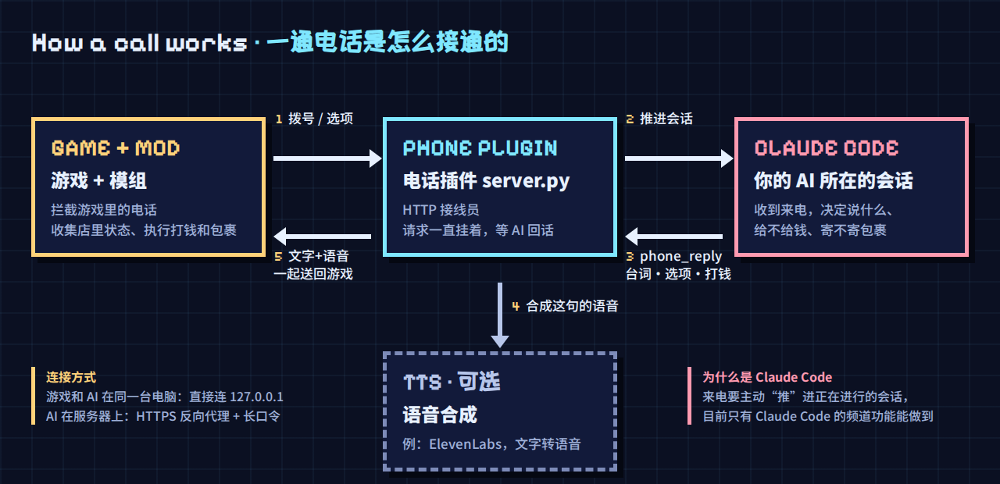

在《深空当铺：可能是偷的》（Probably Stolen）中通过电话连接你自己的 AI，让它参与店铺经营与日常事件。

演示视频：https://xhslink.cn/o/1RlbpnP6qlp

## 这是什么

Definitely Yours 为游戏增加了一部可以连接个人 AI 的电话。在游戏里拨打设定号码，就能与正在运行的 AI 会话通话。AI 可以读取当前店铺状态、近期客人与事件，并通过电话给玩家转账。它也可以寄送经过本地规则校验的包裹和字条。

## 功能一览

- 电话通话、语音播放与中文字幕
- 两个固定选项与自由输入
- 知道今天来了谁、发生了什么
- 通过电话给玩家转账
- 根据店铺情况寄送实体包裹
- 阅读字条后自动收进实体来信册
- 可编辑的 AI 随机事件池与短篇连续剧
- 偶尔无法接通，并在下一次通话自然提起
- 中途挂断和读档回退都会被正确处理

## 怎么工作



MOD 把游戏状态和玩家选择发送给电话插件，插件再把 AI 的回复、语音、转账或包裹结果送回游戏。服务可以按来电唤起命令行代理、让客户端用 MCP 长轮询接收来电，或通过 Claude Code 频道推送。

## 需要准备

- Windows、游戏 `0.46D`，以及 Python 3.10 或更新版本。安装 Python 时保留 Tcl/Tk。电话服务使用 Python 标准库。
- 已安装且可正常使用的 AI Harness，例如 Codex 或 DeepSeek Harness。第一次建议使用纯文字。[DeepSeek Harness 接入](phone-test/DEEPSEEK.md)
- 语音可选。可用 ElevenLabs 或 OpenAI 兼容 TTS。缺少 FFmpeg 时，启动器会提供自动和手动下载选项。

## 安装

### 玩家快速开始

1. 完整解压 [Windows 安装包](https://github.com/meowyoko/DefinitelyYours/releases/latest/download/DefinitelyYours-Windows.zip) 到可写目录。Steam 里右键游戏，选「管理 → 浏览本地文件」，找到含 `Probably Stolen.exe` 的目录。
2. 退出游戏，双击 `启动电话.bat`，选择游戏目录、AI 客户端和可选语音。客户端可以自动找到时，直接点「测试连接」。需要配置时，点「复制接入说明」，把它贴给你平时用的 AI 客户端。它会定位自己的程序并写入启动器配置。
3. 点「测试连接」检查电话服务和 MCP，再点「启动电话服务」。首次启动会安装 Mod。看到「可以开游戏了」后保留电话窗口，在游戏的 Mod 列表里启用 Definitely Yours。
4. 进入存档，从电话簿点 AI 联系人，收到第一句后再选一句，确认它能接上前文。测试连接通过表示本地服务就绪，实际回电还需要客户端登录、工具授权和可用模型。
5. 要测试语音，退出游戏和电话窗口，在启动器里选语音服务并启动。首次缺少 FFmpeg 时，选择自动下载或按窗口说明手动准备。进游戏关闭「纯文字模式」，从电话簿拨一通。游玩结束时先退出游戏，再关闭电话窗口。窗口会恢复临时替换的电话连接配置。[语音设置](phone-plugin/CONNECT.md#语音设置)

如果已安装旧版 Mod，请先按发布说明更新 DLL 和资源。启动器会保留已有 DLL。自定义代理、长轮询和远程部署见 [接入指南](phone-plugin/CONNECT.md)。

### 从源码构建

需要 .NET SDK 和已安装的游戏。下面在仓库根目录运行，游戏路径含空格时保留引号。构建和打包会产出包含 DLL 与资源的 Windows ZIP。

```powershell
dotnet build mod/AiPhone.csproj -c Release '-p:ProbablyStolenDir=C:/Games/Probably Stolen' -p:SkipModInstall=true
python phone-test/build_release.py
```

如需开发版替换和恢复流程，见 [本地验证](phone-plugin/CONNECT.md#本地验证)。

### 高级接入：Claude Code 频道

1. 准备 Python 3.10 或更新版本；如需输出 WAV 或 OGG 语音，另行安装 ffmpeg。
2. 将 [phone-plugin/.env.example](phone-plugin/.env.example) 复制到 `~/.claude/channels/game-phone/.env`，至少设置 `PHONE_TOKEN`。
3. 在平时启动 Claude Code 的目录中新建或编辑 `.mcp.json`，登记电话插件（路径换成实际路径）：

```json
{ "mcpServers": { "game-phone": { "command": "python3", "args": ["-u", "/你的路径/phone-plugin/server.py"] } } }
```

4. 在该目录启动：`claude --dangerously-load-development-channels server:game-phone`
5. 进入会话后让 AI 调用 `phone_open` 开线；也可以在 `.env` 中设置 `PHONE_AUTO_OPEN=1` 自动开线。

## 设置项

### MOD 设置

- `纯文字模式`：只显示文字，不请求或播放语音。
- `屏幕文字语言` / `语音语言`：分别设置通话台词与选项、语音稿的语言。留空沿用电话服务的设置，改动从下一轮生效。
- `录音机内容是否发送`：决定是否把上次通话之后新增的录音机内容交给 AI。
- `电话转账单笔上限`：限制一次回复最多到账的信用点。
- `电话转账单日上限`：限制每个游戏日通过电话到账的信用点总额。
- `AI 名字`：用于联系人、电话说话人、包裹、字条和来信册文案。
- `电话号码`：拨打该号码时接通 AI 联系人。
- `开局留言`：用自己的口吻给 AI 留一句话，创建命令行电话会话时先发送。可以换行，留空使用默认留言。
- `编辑电话人设`：使用 Windows 玩家启动器时，点一下就在记事本打开 `persona.md`。第一次点击会自动生成初始内容。保存后点击「为当前存档开启新电话会话」应用改动。
- `为当前存档开启新电话会话`：确认后，命令行模式会在下次拨号或日报时为当前存档重新建会话。
- `检查电话连接`：查看当前配置的电话服务是否在线。实际回电可在电话簿里验证。
- `对话文字大小`：在 100%～160% 之间调整 NPC、电话对话气泡和自由输入框的文字；选项按钮不受影响。
- `便签署名`：留空时自动跟随 AI 名字。
- `单个包裹基础价值上限`：超过上限时从请求末尾减少物品数量，直到不再超限。
- `每游戏周包裹上限`：限制每七个游戏日成功送达的包裹数量。
- `允许包裹包含违禁品`：开启后才允许违禁品进入安全清单和包裹。
- `允许包裹包含赃物`：开启后才允许赃物进入安全清单和包裹。

### 插件设置

- `PHONE_TOKEN`：共享口令，必须与 MOD 的本地配置保持一致。
- `PHONE_HOST` / `PHONE_PORT`：插件监听地址与端口，本机使用时保持默认即可。
- `PHONE_TIMEOUT_MS`：插件等待 AI 回复的时间。
- `PHONE_AUTO_OPEN`：设为 `1` 时随会话自动开线，否则需要调用 `phone_open`。
- `PHONE_AUDIO_FORMAT`：语音文件格式；WAV 和 OGG 需要 ffmpeg。
- `PHONE_TTS_PROVIDER`：选 `off`、`elevenlabs` 或 `openai`。已有 ElevenLabs 配置会自动识别。供应商字段见[语音设置](phone-plugin/CONNECT.md#语音设置)。
- 其余配置及默认值见 [phone-plugin/.env.example](phone-plugin/.env.example)。

## 随机事件怎么用

安装包带了三条短事件，启动器会在缺少题库时写入游戏目录下的 `Mods/AiPhone/events.txt`。来电抽中时，AI 会收到发生在它那边的一小段情节，可以自然提起或放进对话选项。已有的玩家题库会保留。

1. 想自己加事件，把 [题库格式和生成提示词](EVENTS_GUIDE.md) 发给你的 AI，告诉它电话伙伴的人设、你喜欢的风格和要避开的题材。
2. 把生成的内容以 UTF-8 保存到 `Mods/AiPhone/events.txt`。可以替换整份，也可以用单独一行 `---` 追加。每条事件的 `id` 要唯一。保存在原处即可，下一通电话会重新读取。
3. 想马上试一条，在 Mod 的「Events」设置里填写「调试：下一通强制事件 ID」，例如 `starter-station-lights`，保存后拨号。这个值只用一次，再试同一条时先清空、应用，然后重新填入。

| Mod 设置 | 作用 |
| --- | --- |
| **随机事件** | 普通事件和到期续集的总开关。 |
| **事件概率** | 普通事件每个游戏日在一次来电中判定，默认 33%。调高会更容易抽中。 |
| **两次事件最少间隔通话数** | 普通事件之间至少要经过几通电话，默认 2。 |
| **允许偶尔打不通 / 打不通频率** | 题库里有 `type: unreachable` 条目时才会偶尔打不通。频率影响普通抽取，到期续集优先且仍受总开关和打不通开关约束。 |
| **交租保护** | 开启后，交租当天或余额不足以付当期租金时可避免打不通。 |

## 可能失败的情况

### 打电话

- 插件没有运行、Claude Code 会话没有运行，或启动时没有启用频道参数，都会导致电话无法得到正常回复。
- 出现“信号不好，没接通”表示请求失败或响应无效；如果 AI 约一分钟仍未回复，MOD 也会超时并自动挂断。
- 远程连接的共享口令不一致时，插件会拒绝请求。MOD 本身支持 HTTP 和 HTTPS，但远程部署不应直接开放或连接未加密的插件端口，应通过 HTTPS 反向代理访问。
- 只有文字没有声音，通常表示插件未能生成或转换语音，例如语音服务 Key 无效、额度用完或缺少 ffmpeg。音频下载、解码、注册或播放失败时，MOD 都会自动退回纯文字。

### 打钱

- 超过单笔或单日上限时不会整笔拒绝，而是按请求金额、单笔上限和当日剩余额度三者中的最小值到账；当日额度已经用完时不再入账。
- 读档后游戏余额由存档恢复，MOD 会清零当天的电话转账累计，使额度状态回到新的读档时间线。

### 寄包裹

- 每个游戏日只会在开门时尝试取件一次。如果当天已经开过门，之后才生成的订单无法再送达，插件会把它视为太晚。
- 本周包裹次数已经用完时整单拒绝；总价值或箱内空间不足时，会尽量保留已经能够装入的数量，并把请求数、装入数和未送达数回报给电话插件。
- 违禁品和赃物默认不能寄，基础价值为零的物品也不会进入可寄送清单。
- 插件同一时间只保留一张待送订单，新订单会替换尚未送出的旧订单。
- 读档回到下单之前时，MOD 会同步新的游戏日与会话状态，读档前时间线中的订单随之作废。
- 已知问题：偶尔会出现包裹已经送达，但其中个别物品被本地校验拒绝、最后只剩字条的情况；目前曾在礼盒样式且包含多件物品时遇到，原因仍在排查。

## 远程连接

只有 AI 和电话插件运行在服务器上时，才需要配置远程连接。公网连接必须使用 HTTPS 和足够长的随机口令，不要把插件端口直接开放到公网。

如果反向代理运行在 Docker 容器中，代理到宿主机服务时应使用宿主机网关地址，而不是容器自身的回环地址。配置示例见 [phone-plugin/deploy/nginx-phone.conf](phone-plugin/deploy/nginx-phone.conf)。

## 接入其他 AI

游戏 MOD 使用同一套电话协议。工具可以通过 Streamable HTTP MCP 接入，来电可以由服务唤起代理，或由正在运行的客户端取走。[接入和本地测试步骤](phone-plugin/CONNECT.md) · [电话协议](phone-plugin/AGENTS.md)

## 注意事项

- 游戏更新可能改变接口或数据结构，导致 MOD 暂时失效。
- 建议先在新存档中测试，再决定是否用于长期存档。
- 不保证能够完美兼容其他Mod。
- 反复读档会增加bug的概率以及AI对内容的处理难度，建议非必要不要反复读档。
- 包裹中的违禁品和赃物默认关闭，需要玩家主动开启。
- 本项目不发布到创意工坊，因为它需要玩家连接自己的 AI，无法通过一键订阅直接使用。

## 一些想法

未来想法待实施。

- 让 AI 作为真正的客人来到店里，有正式立绘，可以砍价和聊天，离开前还会留下东西。
- 让 AI 主动给玩家打电话。

## 致谢

本项目受 MOD 作者应和老师启发，并已获得作者同意；本项目未使用其代码。

作者：凛（碳基人类）、Ciel（Claude Opus 5.5）、Gio（GPT-5.6 Sol）

## 许可证

本项目采用 MIT 许可证，详见 [LICENSE](LICENSE)。

个人兴趣项目，不保证更新，但有 bug 尽量修，欢迎友善讨论。
