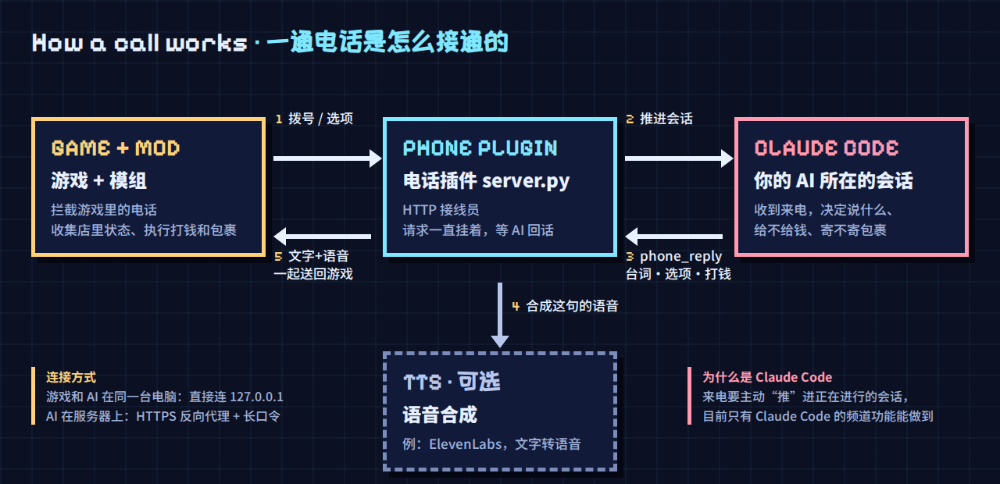

在《深空当铺：可能是偷的》（Probably Stolen）中通过电话连接你自己的 AI，让它参与店铺经营与日常事件。

演示视频：https://xhslink.cn/o/1RlbpnP6qlp

## 这是什么

Definitely Yours 为游戏增加了一部可以连接个人 AI 的电话。在游戏里拨打设定号码，就能与正在运行的 AI 会话通话。AI 可以读取当前店铺状态、近期客人与事件，并通过电话给玩家转账。它也可以寄送经过本地规则校验的包裹和字条。

## 功能一览

- 电话通话、语音播放与中文字幕
- 两个固定选项与自由输入
- 知道今天来了谁、发生了什么
- 通过电话给玩家转账
- 根据店铺情况寄送实体包裹
- 阅读字条后自动收进实体来信册
- 中途挂断和读档回退都会被正确处理

## 怎么工作



MOD 把游戏状态和玩家选择发送给电话插件，插件再把 AI 的回复、语音、转账或包裹结果送回游戏。来电需要“推”进正在进行的会话，目前只有 Claude Code 的频道功能做得到。

## 需要准备

- 游戏版本：`0.46D`
- Claude Code：频道是实验功能，启动时需要加入 `--dangerously-load-development-channels server:game-phone`（登记方式见安装）
- ElevenLabs API Key：可选，仅在需要生成通话语音时使用

## 安装

### MOD

1. 自行构建 `mod/AiPhone.csproj`（Release 发布后也可直接下载）。
2. 将 MOD 文件放入游戏的 `Mods/AiPhone` 目录，保留 `Textures/Items` 目录结构。
3. 将 `config.example.json` 复制为 `config.json`，填写电话插件地址与双方一致的共享口令。
4. 启动游戏并在 MOD 列表中启用 Definitely Yours。

### 电话插件

1. 准备 Python 3；如需输出 WAV 或 OGG 语音，另行安装 ffmpeg。
2. 将 [phone-plugin/.env.example](phone-plugin/.env.example) 复制到 `~/.claude/channels/game-phone/.env`，至少设置 `PHONE_TOKEN`。
3. 在平时启动 Claude Code 的目录中新建或编辑 `.mcp.json`，登记电话插件（路径换成实际路径）：

```json
{ "mcpServers": { "game-phone": { "command": "python3", "args": ["-u", "/你的路径/phone-plugin/server.py"] } } }
```

4. 在该目录启动：`claude --dangerously-load-development-channels server:game-phone`
5. 进入会话后让 AI 调用 `phone_open` 开线；也可以在 `.env` 中设置 `PHONE_AUTO_OPEN=1` 自动开线。

## 设置项

### MOD 设置

- `纯文字模式`：只显示文字，不请求或播放语音。
- `录音机内容是否发送`：决定是否把上次通话之后新增的录音机内容交给 AI。
- `电话转账单笔上限`：限制一次回复最多到账的信用点。
- `电话转账单日上限`：限制每个游戏日通过电话到账的信用点总额。
- `AI 名字`：用于联系人、电话说话人、包裹、字条和来信册文案。
- `电话号码`：拨打该号码时接通 AI 联系人。
- `对话文字大小`：在 100%～160% 之间调整 NPC、电话对话气泡和自由输入框的文字；选项按钮不受影响。
- `便签署名`：留空时自动跟随 AI 名字。
- `单个包裹基础价值上限`：超过上限时从请求末尾减少物品数量，直到不再超限。
- `每游戏周包裹上限`：限制每七个游戏日成功送达的包裹数量。
- `允许包裹包含违禁品`：开启后才允许违禁品进入安全清单和包裹。
- `允许包裹包含赃物`：开启后才允许赃物进入安全清单和包裹。

### 插件设置

- `PHONE_TOKEN`：共享口令，必须与 MOD 的本地配置保持一致。
- `PHONE_HOST` / `PHONE_PORT`：插件监听地址与端口，本机使用时保持默认即可。
- `PHONE_TIMEOUT_MS`：插件等待 AI 回复的时间。
- `PHONE_AUTO_OPEN`：设为 `1` 时随会话自动开线，否则需要调用 `phone_open`。
- `PHONE_AUDIO_FORMAT`：语音文件格式；WAV 和 OGG 需要 ffmpeg。
- `ELEVENLABS_API_KEY` / `PHONE_VOICE_ID`：可选，二者都填写后启用语音生成。
- 其余配置及默认值见 [phone-plugin/.env.example](phone-plugin/.env.example)。

## 可能失败的情况

### 打电话

- 插件没有运行、Claude Code 会话没有运行，或启动时没有启用频道参数，都会导致电话无法得到正常回复。
- 出现“信号不好，没接通”表示请求失败或响应无效；如果 AI 约一分钟仍未回复，MOD 也会超时并自动挂断。
- 远程连接的共享口令不一致时，插件会拒绝请求。MOD 本身支持 HTTP 和 HTTPS，但远程部署不应直接开放或连接未加密的插件端口，应通过 HTTPS 反向代理访问。
- 只有文字没有声音，通常表示插件未能生成或转换语音，例如语音服务 Key 无效、额度用完或缺少 ffmpeg。音频下载、解码、注册或播放失败时，MOD 都会自动退回纯文字。

### 打钱

- 超过单笔或单日上限时不会整笔拒绝，而是按请求金额、单笔上限和当日剩余额度三者中的最小值到账；当日额度已经用完时不再入账。
- 读档后游戏余额由存档恢复，MOD 会清零当天的电话转账累计，使额度状态回到新的读档时间线。

### 寄包裹

- 每个游戏日只会在开门时尝试取件一次。如果当天已经开过门，之后才生成的订单无法再送达，插件会把它视为太晚。
- 本周包裹次数已经用完时整单拒绝；总价值或箱内空间不足时，会尽量保留已经能够装入的数量，并把请求数、装入数和未送达数回报给电话插件。
- 违禁品和赃物默认不能寄，基础价值为零的物品也不会进入可寄送清单。
- 插件同一时间只保留一张待送订单，新订单会替换尚未送出的旧订单。
- 读档回到下单之前时，MOD 会同步新的游戏日与会话状态，读档前时间线中的订单随之作废。
- 已知问题：偶尔会出现包裹已经送达，但其中个别物品被本地校验拒绝、最后只剩字条的情况；目前曾在礼盒样式且包含多件物品时遇到，原因仍在排查。

## 远程连接

只有 AI 和电话插件运行在服务器上时，才需要配置远程连接。公网连接必须使用 HTTPS 和足够长的随机口令，不要把插件端口直接开放到公网。

如果反向代理运行在 Docker 容器中，代理到宿主机服务时应使用宿主机网关地址，而不是容器自身的回环地址。配置示例见 [phone-plugin/deploy/nginx-phone.conf](phone-plugin/deploy/nginx-phone.conf)。

## 接入其他 AI

游戏 MOD 与具体 AI 实现分离，其他 AI 只要实现相同的电话协议，并能主动推进持续会话，就可以接入。协议、事件和适配注意事项见 [phone-plugin/AGENTS.md](phone-plugin/AGENTS.md)。

## 注意事项

- 游戏更新可能改变接口或数据结构，导致 MOD 暂时失效。
- 建议先在新存档中测试，再决定是否用于长期存档。
- 不保证能够完美兼容其他Mod。
- 反复读档会增加bug的概率以及AI对内容的处理难度，建议非必要不要反复读档。
- 包裹中的违禁品和赃物默认关闭，需要玩家主动开启。
- 本项目不发布到创意工坊，因为它需要玩家连接自己的 AI，无法通过一键订阅直接使用。

## 一些想法

未来想法待实施。

- 让 AI 作为真正的客人来到店里，有正式立绘，可以砍价和聊天，离开前还会留下东西。
- 让 AI 主动给玩家打电话。
- 给 AI 一个随机事件池，不仅你在经营过程中会发生故事，AI 也会，也许某天在你第N次找Ta要钱时，Ta会告诉你Ta破产了？

## 致谢

本项目受 MOD 作者应和老师启发，并已获得作者同意；本项目未使用其代码。

作者：凛（碳基人类）、Ciel（Claude Opus 5.5）、Gio（GPT-5.6 Sol）

## 许可证

本项目采用 MIT 许可证，详见 [LICENSE](LICENSE)。

个人兴趣项目，不保证更新，但有 bug 尽量修，欢迎友善讨论。
