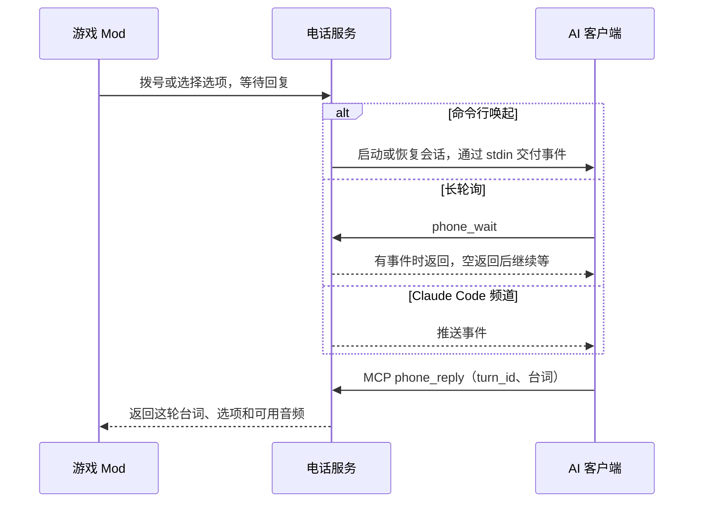

# 电话服务接入

`PHONE_WAKE_MODE` 选择 `cli`、`poll` 或 `claude`。三个模式共用游戏的 `/phone/*` 接口。`cli` 和 `poll` 由 `python server.py` 启动常驻服务，AI 工具地址为 `http://127.0.0.1:3900/mcp`。让游戏以 `X-Phone-Token` 提交 `PHONE_TOKEN`，让 MCP 客户端以 Bearer 提交单独的 `PHONE_MCP_TOKEN`。使用 `.env.example` 配置服务，`PHONE_STATE_DIR` 可指定一个独立的本地测试目录。

## 游戏电话怎么接通

游戏发出拨号或选项请求后，电话服务保留这次请求，并给这一轮分配一个 `turn_id`。三种接入方式负责把同一类事件交给 AI。AI 用 `phone_reply` 把台词交回电话服务，服务再完成游戏正在等的请求。每次点选项，都会走一轮同样的流程。



## AI 客户端接入的硬性要求

需要的是一套能接收游戏事件、调用 MCP 工具并把结果送回游戏的 AI 客户端或 Agent。只有普通聊天界面或文本生成 API 时，需要加一层能完成这些操作的 Agent。

- **能实际调用工具。** 游戏只读电话服务返回的结果。服务用 `turn_id` 找到还在等待的那一轮，拒绝过期、重复或对不上号的回复。所以 AI 收到来电或选项后，要用原始 `turn_id` 和台词 `text` 调用 `phone_reply`，每轮成功提交一次。日报是后台事件，按接入模式收尾。
- **能在电话时限内回复。** 游戏发出请求后就在等，默认从服务收件起给 AI 42 秒提交回复。排队、客户端启动、模型推理和等待工具授权都消耗同一段时间。语音模式下，AI 按提示提交 `voice_text`，电话服务先合成再随文字返回。按时提交语音稿后，合成最多另等 5 秒，音频来不及就先返回文字。
- **能走通下列任一接入模式。**

| 模式 | 客户端还必须具备的能力 | 为什么需要 |
| --- | --- | --- |
| 命令行唤起 `cli` | 能非交互启动、从 stdin 读 UTF-8 来电、连接带 Bearer 认证的 Streamable HTTP MCP。新建时在 stdout 输出服务能识别的 JSONL 会话 ID（Codex `thread.started` 事件里的 `thread_id`，或顶层 `sessionId`），能按 ID 恢复历史，回完及时退出。其他输出格式可用包装脚本转换。 | 每轮由服务启动一个进程，靠 stdout 拿到 ID、按存档恢复历史。工具通过 HTTP 回到持有本轮请求的常驻服务。旧进程退出后，队列才能启动下一轮。 |
| 长轮询 `poll` | 能连接带 Bearer 认证的 Streamable HTTP MCP，并持续调用 `phone_wait`。客户端的单次工具超时要超过 240 秒；空返回、回复通话或用 `phone_done` 收完日报后，都继续等。 | 电话服务通过挂起的 `phone_wait` 交付事件。一次最多等 240 秒，客户端继续等才有接收下一个事件的入口。 |
| Claude Code 频道 `claude` | 能启动 stdio MCP 服务并接收 Claude Code 的频道通知，收到通知后能调用电话工具。 | 来电由服务主动推送，需要客户端识别频道通知并触发一轮处理。 |

命令行模式会按存档自动创建和续跑会话。长轮询和频道模式若要按存档延续上下文，需由客户端自己管理会话。Windows 玩家使用 Codex 或 DSH 时可从 [玩家快速开始](../README.md#玩家快速开始) 进入。

## 命令行唤起

1. 玩家可在 Mod 设置中点击「编辑电话人设」。独立部署可在 `.env` 同目录创建 `persona.md`，写下自己的角色和说话规则。旧版 `phone-profile.txt` 的内容可直接移到 `persona.md`。也可以用 `PHONE_PERSONA_DIR` 指定人设所在目录。
2. 配置 `PHONE_CLI_CREATE` 和 `PHONE_CLI_RESUME` 为 JSON 参数数组。服务以 UTF-8 从 stdin 交付提示词，以 JSONL 从 stdout 读取会话 ID。续跑模板中的 `{session}` 会替换为该存档已有的 ID。Windows 可填实际 `.exe` 路径，Node CLI 可填写 `node.exe` 和入口 JS 两个参数。命令以参数数组直接启动。
3. 在 AI 客户端配置同一个 Streamable HTTP 地址和 Bearer 认证。Codex 的 `config.toml` 示例如下。让服务运行时的 Codex 子进程能读到 `PHONE_MCP_TOKEN`。

```toml
[mcp_servers.game_phone]
url = "http://127.0.0.1:3900/mcp"
bearer_token_env_var = "PHONE_MCP_TOKEN"
required = true
default_tools_approval_mode = "approve"
```

电话的非交互进程需要预先批准这个 MCP 服务器的工具，才能把回复送回游戏。

```dotenv
PHONE_WAKE_MODE=cli
PHONE_CLI_CREATE=["codex","exec","--skip-git-repo-check","--json","-"]
PHONE_CLI_RESUME=["codex","exec","resume","--skip-git-repo-check","--json","{session}","-"]
```

新建游戏存档会排入一次电话初始化。已有存档如果首次接入，就在第一次电话或日报时创建会话。初始化只确认人设和规则。服务把会话 ID 保存在状态目录里的 `sessions.json`。换代理先在该代理里登记同一个 MCP 地址，再替换两个命令模板并重启电话服务。不同模板各自维护会话 ID，支持 Codex 的 `thread.started.thread_id` 和 DeepSeek Harness 的 `sessionId`。DeepSeek 的两种模板可使用 `dsh --profile headless --json -` 和 `dsh --profile headless --json --session-id {session} -`。

在 Mod 的 Phone 设置里填写「开局留言」并应用。新会话的第一条消息从玩家的留言开始，随后是人设和电话规则。留空时使用游戏的默认开场。更改留言后，下一条新建的电话会话会读取新版。

DeepSeek Harness 的 `headless` 进程需要能访问已配置的模型凭据。如果报告 `MISSING_CREDENTIAL`，在它的 Models 设置里配置官方模型，或让服务的启动环境提供 `DEEPSEEK_API_KEY`。

本机 Windows 用户可按 [DSH 接入指南](../phone-test/DEEPSEEK.md) 安装 DSH、选择预设并拨号测试。

### 让自己的 AI 配置其他命令行客户端

玩家可以选「其他客户端」，点「复制接入说明」并粘贴给自己的 AI。Windows 玩家入口读取 `phone-test/player-config.json`。说明会让 AI 保留已填的游戏和语音设置，并为 `client: "custom"`、`wakeMode: "cli"` 填 `cliCreate` 和 `cliResume`。程序路径和每个参数分别占一个数组元素。Windows 优先调用真实程序或解释器，脚本入口路径作为单独参数。独立常驻服务则在自己的 `.env` 中设置对应变量。

| 玩家配置 | 独立服务 | 用途 |
| --- | --- | --- |
| `cliCreate`、`cliResume` | `PHONE_CLI_CREATE`、`PHONE_CLI_RESUME` | 两个 JSON 参数数组。新建和续跑均从 stdin 读 UTF-8，续跑数组包含 `{session}`。 |
| `cliSessionField` | `PHONE_CLI_SESSION_FIELD` | stdout 每行 JSON 中的会话 ID 字段，支持 `session_id` 和 `session.id` 这类点分字段。留空时兼容 Codex 的 `thread.started.thread_id` 和 DSH 的 `sessionId`。 |
| `cliProfile` | `PHONE_CLI_PROFILE` | 给同一个 Agent 会话库固定取个名字，程序路径或选项变动时继续按存档查找。更换 Agent 或会话库时用另一个名字。留空沿用按命令匹配的旧方式。 |

内置 Codex 与 DSH 预设各自按固定名称绑定会话。已有手写测试模板按旧方式继续匹配。把它们切成内置预设时，玩家入口会在自己的状态目录里创建新会话。

### MCP 地址和口令

- 游戏填电话服务根地址，用 `X-Phone-Token`。AI 在 HTTP MCP 客户端填带 `/mcp` 的地址，用 `Authorization: Bearer <PHONE_MCP_TOKEN>`。模型登录凭据由 AI 客户端管理。
- 命令行模式里，服务启动的子进程可读取 `PHONE_MCP_TOKEN`。Codex 用 TOML 的 `bearer_token_env_var`，DSH 用 YAML 的 `headers.Authorization`。Claude Code 的 HTTP MCP 配置使用 `type: "http"`、`url` 和 `headers.Authorization`。选用项目的 Claude Code 频道模式时，仍按 README 登记 stdio 频道。[DSH 配置示例](../phone-test/dsh-mcp.example.yml) · [Claude Code MCP](https://code.claude.com/docs/en/mcp)
- 对于外部桌面客户端，使用固定端口，并给服务和客户端配置同一个 MCP Bearer 口令。其他命令行客户端如果通过自己的配置文件登记 MCP，也需要固定端口。访问电话服务的 `/phone/health` 可以判断服务是否在线。还应在客户端查看是否能列出 `phone_reply`，再进游戏拨号。
- 自带反代示例只转发游戏的 `/phone/`。当 AI 在电话服务同一台机器时，用本机 `/mcp`。只有 AI 客户端也要跨机器连接时才另行代理 `/mcp`，保留 HTTPS 和 Bearer 认证，并为长轮询保留超过 240 秒的上游读取超时。

来电、选项和日报进入同一条队列。来电和选项从服务收到 HTTP 请求开始计时，默认给 AI 42 秒交稿，排队也算在内。按时交了语音稿并开始合成时，音频可额外使用最多 5 秒。音频就绪后会和文字一起返回，超过语音时限则只返回文字。报告是后台工作，游戏收到入队确认即可继续。报告和新档初始化的进程运行时间另有 `PHONE_CLI_BACKGROUND_TIMEOUT`，默认 300 秒。睡前日报处理得太晚时，次晨已经开门的包裹不能补投。

电话回复由 `phone_reply` 提交。其他工具先用，`phone_reply` 成功后立即结束这轮。服务先向游戏返回可交付回复，旧进程退出后再开始下一轮。日报不调用 `phone_reply`，处理完后直接退出。

## 长轮询与 Claude Code

- `poll` 模式下，客户端在一个活跃会话中调用 `phone_wait`，最多阻塞 240 秒。`null` 表示继续等。收到 `call` 或 `choice` 就用返回的 `turn_id` 调用 `phone_reply`，收到 `daily` 则用 `phone_done` 收尾，然后继续 `phone_wait`。客户端工具超时应高于 240 秒，Codex 可设置 `tool_timeout_sec = 300`。
- `claude` 模式继续使用 Claude Code 的 stdio MCP 和频道通知，客户端启动 `server.py` 后用 `phone_open` 开线。安装方式见[项目 README](../README.md)。
- 命令行模式由服务自动创建和恢复实际的代理会话。长轮询和频道推送把存档标识交给已连接的客户端，由客户端管理自己的会话。一个普通的桌面聊天窗口不会由 MCP 工具自动切换聊天。

## 存档与协议

- `saveId` 是游戏的存档栏位和经营局 ID 组合。`timeline` 在新建或读档时更新。游戏先通过 `/phone/session` 通知服务，`reason` 为 `new` 或 `load`。读档会使旧轮次失效，下一轮开头会收到回退到第几天的提醒。
- 在 Mod 设置里点击「为当前存档开启新电话会话」并确认。待拨号或发日报时，服务为当前存档建立新的 CLI 会话。旧会话可在代理自己的历史里查阅。
- 同一通电话用 `callToken` 关联拨号、选项和挂断。`phone_reply` 使用服务给出的 `turn_id`。CLI 和长轮询模式的 `phone_send_parcel` 也需要带当前 `turn_id`，包括日报寄件。
- 包裹状态按 `saveId` 存在 `parcels-by-save.json`。老版没有存档标识的 `parcels.json` 继续供老客户端使用，其订单无法自动判断属于哪个新存档。

## 本地验证

Windows 下先退出游戏，再双击仓库根目录的 `开始测试.bat`。看到「可以开游戏了，拨 10000」后开游戏。测试结束先退出游戏，再按 Ctrl+C 或关闭测试窗口。后台会恢复原 DLL 和配置。如果先关了窗口，后台会等游戏退出。自动恢复失败时，退出游戏后双击 `恢复原配置.bat`。

把 [`phone-test/test-config.example.json`](../phone-test/test-config.example.json) 复制为本机的 `test-config.json`。本地测试使用已构建的 Release DLL。默认预设用 Codex，`port: 0` 自动选本机端口。选 `poll` 时，桌面客户端需要用 `mcpTokenEnv` 指定的环境变量作为 Bearer 口令，并在配置里填固定端口。选 `claude` 时，先按项目 README 登记 Claude Code 频道，测试脚本会另开一个客户端窗口。

内置 Codex 预设沿用客户端默认模型。需要覆盖时填写 `cliModel`。自定义启动和续跑模板中的 `{model}` 也使用这个值。DSH 预设沿用其 headless 模型设置。

通过 Windows 启动器运行本机电话服务后，可在 Mod 设置里点击「编辑电话人设」。第一次点击会在启动器目录生成 `phone-test/persona.md` 并在记事本打开。已有玩家文件直接打开。独立或远程部署可在服务侧手动编辑人设。

没有人设文件或内容为空时，服务自动使用内置人设。命令行模式只在创建会话时发送完整人设。改完后可用 Mod 设置「为当前存档开启新电话会话」启用新版。长轮询和 Claude 频道在人设所属的 MCP 客户端连接初始化时提供一次，编辑后重新连接即可读取。

## 语音设置

玩家入口默认关闭语音。要使用语音，在启动器下拉框选择服务并填好配置。启动后进游戏，关闭「纯文字模式」，从电话簿拨一通来检查实际播放。

| 服务 | 配置 |
| --- | --- |
| 关闭 | 纯文字模式，无需服务地址或凭据。 |
| ElevenLabs | API Key、音色 ID，可选模型。已有配置和开关会自动沿用。 |
| OpenAI 兼容 TTS | 完整的语音接口地址、模型、音色。自托管服务可留空 Key。非本机地址使用 Key 时需用 HTTPS。 |

兼容接口填写完整地址，如 `http://127.0.0.1:8000/v1/audio/speech`。服务会发送 `input`、`model`、`voice` 和 `response_format: "mp3"`，需要接口直接返回 MP3 音频。[OpenAI Speech API](https://developers.openai.com/api/reference/resources/audio/subresources/speech/methods/create)

启动器把服务选项存到本地 `player-config.json`，把语音凭据和供应商配置写到旁边的 `.env`。开发测试可按 [`phone-test/.env.example`](../phone-test/.env.example) 配置。独立常驻服务用自己的 [`.env`](.env.example)。独立服务和开发测试未设置 `PHONE_TTS_PROVIDER` 时，会继续识别已有的 ElevenLabs 配置。

游戏播放的是 WAV。电话服务用 FFmpeg 将供应商的 MP3 转为游戏可播放的格式。启用语音并点「启动电话服务」时，会先查启动器目录下的 `.phone-test-state/bin/ffmpeg.exe`，再查 PATH。两处都没有时，可以选择自动下载约 109 MB 的 Windows 便携版，或复制窗口显示的手动下载说明。手动下载后从 ZIP 的 `bin` 目录取出 `ffmpeg.exe`，放到启动器同目录下的 `.phone-test-state/bin/`，再点一次「启动电话服务」。[下载来源](https://github.com/GyanD/codexffmpeg/releases/tag/9.0.2)

语音会与文字同步返回，合成超时或失败时返回文字。测试日志记录「首轮语音耗时」和音频是否就绪。游戏日志记录拨号到显示回复的耗时及是否实际播放。

本地测试可在 `phone-test/test-config.json` 用 `voiceLanguage` 和 `textLanguage` 分别指定语音和屏幕文字语言。当前配置使用英文语音和简体中文字幕与选项，设置每轮都会传给 AI。

玩家入口写到本地 `phone-test/player-config.json`，首次保存采用英文语音、简体中文台词和 `-16` LUFS 的 WAV 响度预设。在 Mod 设置里填写「屏幕文字语言」或「语音语言」会覆盖相应的预设，留空沿用电话服务设置。语言在下一轮通话或选项生效，可继续使用现有会话。WAV 响度仍在电话服务配置里调整。

本地测试还可用 `voiceLoudnessLufs` 设置 WAV 的目标响度。当前为 `-16` LUFS，重开测试服务后对新生成的语音生效。

在仓库根目录执行 `python -m unittest discover -s phone-plugin/tests -v`。真实客户端验收时，先用纯文字拨号，再马上点一个选项，确认两轮都接通且续同一会话。切换到另一个存档后确认会话不同，读回原档确认续到原会话且首轮收到回退提示。首次打开实例时使用本机测试地址和独立状态目录。
